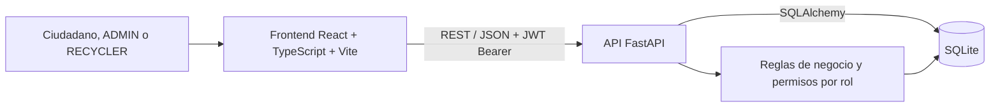

# EcoPunto Autónomo

Plataforma web de economía circular para registrar depósitos virtuales de materiales, asignar EcoPuntos y gestionar la capacidad de compartimentos y su recolección.

## Presentación y alcance

EcoPunto representa mediante software una máquina de reciclaje y sus operaciones. **Es un simulador virtual:** no se conecta a sensores, básculas, cámaras, microcontroladores ni dispositivos IoT. El ciudadano selecciona el material y registra manualmente el peso; el backend valida la operación, calcula los puntos y actualiza el compartimento.

El proyecto está en desarrollo. La interfaz y la API cubren varias operaciones reales, mientras que algunos paneles, métricas y flujos continúan siendo demostrativos o están pendientes. La clasificación por visión artificial no forma parte de la configuración actual.

## Funcionalidades por rol

### Ciudadano — CITIZEN

**Implementado y conectado:** registro público de ciudadanos, inicio de sesión, consulta del perfil, consulta de EcoPuntos/materiales/compartimentos, registro de depósitos, cálculo de puntos en el backend, consulta del saldo, historial propio de depósitos y transacciones.

**En desarrollo:** el dashboard principal y la pantalla “Mis EcoPuntos” aún muestran indicadores de demostración; beneficios y redenciones no tienen endpoints.

### Administrador — ADMIN

**Implementado y conectado:** gestión de EcoPuntos, materiales y compartimentos desde la pantalla administrativa; la API valida el rol en operaciones de escritura.

**En desarrollo:** dashboard y métricas reales, gestión visual de alertas, consulta operativa de recolecciones, listado general de depósitos y administración visual de usuarios. El backend no expone un endpoint de listado general de depósitos.

### Reciclador — RECYCLER

**Implementado en backend:** consulta de alertas, creación y consulta de recolecciones, consulta de sus propias recolecciones. Una recolección completa actualiza el peso del compartimento y puede resolver alertas.

**Pendiente en frontend:** conectar el panel, las alertas, la selección de compartimentos, el formulario de recolección y el historial.

El detalle de endpoints y permisos está en [backend/README.md](backend/README.md). La guía breve del cliente está en [frontend/README.md](frontend/README.md).

## Arquitectura



El navegador llama a la API bajo `/api/v1`. Las rutas privadas reciben `Authorization: Bearer <access_token>`. FastAPI valida token y permisos, aplica las reglas de negocio y persiste los datos con SQLAlchemy en SQLite. El frontend mantiene el token en memoria; al recargar la página hay que iniciar sesión de nuevo.

## Tecnologías y versiones configuradas

Las versiones de Node/Frontend se toman de `frontend/package.json`; son rangos compatibles, no una afirmación de que cada dependencia esté fijada a una única versión.

| Componente | Versión o requisito del proyecto |
| --- | --- |
| Python | 3.11 o posterior, indicado por la guía actual del backend |
| FastAPI | `>=0.115,<1.0` |
| Uvicorn | `>=0.30,<1.0` |
| SQLAlchemy | `>=2.0,<3.0` |
| Pydantic Settings | `>=2.6,<3.0` |
| PyJWT | `>=2.9,<3.0` |
| React / React DOM | `^19.3.1` |
| TypeScript | `~6.0.3` |
| Vite | `^8.3.6`; el runtime Vite instalado declara Node `^20.19.0` o `>=22.12.0` |
| Node.js | Instalar una versión que cumpla el requisito de Vite |
| npm | Incluido con Node.js; `frontend/package-lock.json` permite instalar con `npm ci` |
| Base de datos | SQLite, mediante SQLAlchemy |
| Pruebas backend | pytest y httpx, declarados en `backend/requirements.txt` |

Las dependencias Python y JavaScript están declaradas en `backend/requirements.txt` y `frontend/package.json`. No se configura OpenCV, un modelo de visión, Alembic ni un servicio de base de datos externo.

## Requisitos previos

- Git para clonar y colaborar en el repositorio.
- Visual Studio Code (opcional pero recomendado). Extensiones útiles: Python, Pylance y ESLint. No son necesarias para ejecutar la aplicación.
- Python 3.11 o posterior, con el comando `python` o el lanzador `py` disponible en PowerShell.
- Node.js que cumpla el requisito de Vite (Node 20.19+ dentro de la rama 20, o 22.12+; una versión posterior compatible también sirve) y npm.
- Acceso al repositorio privado de GitHub.

Comprueba las herramientas desde PowerShell:

```powershell
git --version
python --version
node --version
npm --version
```

Si Windows no reconoce `python`, instala Python y activa la opción para agregarlo al `PATH`; alternativamente usa el lanzador `py` si se instaló con Python.

## Obtener el proyecto

Antes de clonar, cada integrante debe tener acceso al repositorio privado y aceptar la invitación de GitHub. Después, desde PowerShell:

```powershell
git clone https://github.com/alerojas-2005/ecopunto-autonomo.git
cd ecopunto-autonomo
code .
```

Si el comando `code` no está disponible, abre VS Code y selecciona **File > Open Folder** (en español, **Archivo > Abrir carpeta**); elige la carpeta clonada `ecopunto-autonomo`.

## Configuración del backend

Los siguientes comandos parten de la raíz del repositorio y usan Windows PowerShell. Primero crea un entorno virtual e instala las dependencias del manifiesto:

```powershell
cd backend
py -3.11 -m venv .venv
```

Si no tienes el lanzador `py`, usa `python -m venv .venv` después de instalar Python 3.11 o posterior. Activa el entorno e instala:

```powershell
.\.venv\Scripts\Activate.ps1
python -m pip install -r requirements.txt
```

Si PowerShell impide activar el entorno, puedes ejecutar Python directamente desde el entorno virtual:

```powershell
.\.venv\Scripts\python.exe -m pip install -r requirements.txt
```

### Variables de entorno

Crea `backend/.env` a partir de la plantilla solo si aún no tienes uno. No reemplaces un `.env` existente:

```powershell
if (-not (Test-Path .env)) { Copy-Item .env.example .env }
```

Abre `backend/.env` localmente y configura tus propios valores. Nunca los pegues en el repositorio, en capturas ni en este README.

| Variable | Uso | Valor predeterminado o regla |
| --- | --- | --- |
| `DATABASE_URL` | URL de SQLAlchemy | `sqlite:///./ecopunto.db` |
| `JWT_SECRET_KEY` | Firma de JWT | Se recomienda configurar una clave privada de al menos 32 caracteres |
| `ACCESS_TOKEN_EXPIRE_MINUTES` | Vigencia del token | `30`; el backend acepta de 1 a 1440 minutos |
| `CORS_ORIGINS` | Orígenes permitidos por CORS | JSON; por defecto incluye `http://localhost:5173` y `http://127.0.0.1:5173` |
| `BOOTSTRAP_ADMIN_TOKEN` | Habilita la creación del primer administrador | Opcional; requiere un valor privado de al menos 32 caracteres |

Para generar valores aleatorios localmente puedes ejecutar dos veces el generador siguiente y copiar cada salida directamente a tu archivo local `.env` en la variable correspondiente:

```powershell
python -c "import secrets; print(secrets.token_urlsafe(48))"
```

Sin `JWT_SECRET_KEY`, el backend usa una clave efímera del proceso y los tokens dejan de servir al reiniciarlo. Sin `BOOTSTRAP_ADMIN_TOKEN` válido, la ruta para crear el primer ADMIN permanece deshabilitada.

### Datos iniciales y base de datos

Desde `backend/`, ejecuta el seed opcional para crear los materiales Aluminio y PET, un EcoPunto de ejemplo y sus compartimentos:

```powershell
python -m app.seed
```

El seed es idempotente para esos registros y no crea usuarios ni contraseñas. Los factores configurados por el seed son 0.50 EcoPuntos/g para Aluminio y 0.25 EcoPuntos/g para PET. La base SQLite relativa `./ecopunto.db` se crea dentro del directorio desde el que se ejecuta el backend; al iniciar la API se crean tablas faltantes. `create_all` no reemplaza migraciones ni altera automáticamente tablas existentes.

### Crear el primer administrador

El endpoint `POST /api/v1/auth/bootstrap-admin` solo funciona si `BOOTSTRAP_ADMIN_TOKEN` está configurado correctamente y aún no existe un usuario ADMIN. Es una operación de un solo uso por base de datos.

1. Configura localmente `JWT_SECRET_KEY` y `BOOTSTRAP_ADMIN_TOKEN` en `backend/.env`.
2. Inicia la API y abre `http://127.0.0.1:8000/docs`.
3. En `POST /api/v1/auth/bootstrap-admin`, proporciona tu correo, nombre completo y una contraseña propia que cumpla la longitud mínima de 12 caracteres; envía el valor configurado como encabezado `X-Bootstrap-Token`.
4. Inicia sesión en EcoPunto con la cuenta ADMIN creada.

No se incluyen contraseñas ni tokens de ejemplo en la documentación. El registro público de la aplicación crea únicamente cuentas CITIZEN.

### Ejecutar el backend

Desde `backend/`, con el entorno virtual activo:

```powershell
python -m uvicorn app.main:app --reload
```

Si no activaste el entorno virtual:

```powershell
.\.venv\Scripts\python.exe -m uvicorn app.main:app --reload
```

- API: `http://127.0.0.1:8000`
- Swagger/OpenAPI: `http://127.0.0.1:8000/docs`
- Salud: `http://127.0.0.1:8000/health`

### Alternativa macOS/Linux

Desde la raíz del repositorio:

```bash
cd backend
python3 -m venv .venv
source .venv/bin/activate
python -m pip install -r requirements.txt
if [ ! -f .env ]; then cp .env.example .env; fi
python -m app.seed
python -m uvicorn app.main:app --reload
```

Configura `backend/.env` con tus propios secretos antes de crear el ADMIN. Ejecuta el seed únicamente si deseas los datos de ejemplo.

## Configuración del frontend

Abre una segunda terminal desde la raíz del repositorio:

```powershell
cd frontend
if (-not (Test-Path .env)) { Copy-Item .env.example .env }
npm ci
npm run dev
```

La variable `VITE_API_BASE_URL` tiene como valor local de ejemplo `http://127.0.0.1:8000/api/v1`. El cliente HTTP usa esa URL por defecto si no se define la variable. Si cambias el archivo `.env`, reinicia Vite para cargar el valor.

Vite normalmente publica el frontend en `http://localhost:5173`. Si el puerto está ocupado, puede usar otro; en ese caso agrega el nuevo origen a `CORS_ORIGINS` en `backend/.env` y reinicia el backend.

### Alternativa macOS/Linux

```bash
cd frontend
if [ ! -f .env ]; then cp .env.example .env; fi
npm ci
npm run dev
```

## Ejecutar ambos componentes

Se necesitan dos terminales de VS Code abiertas en la carpeta del proyecto.

**Terminal 1 — backend:** sigue la configuración del backend, activa `.venv`, entra a `backend/` y ejecuta `python -m uvicorn app.main:app --reload`. La API queda en `http://127.0.0.1:8000`.

**Terminal 2 — frontend:** entra a `frontend/`, ejecuta `npm ci` (la primera vez) y `npm run dev`. Abre la URL que muestre Vite, normalmente `http://localhost:5173`.

El seed solo es necesario si necesitas los materiales, EcoPunto y compartimentos de ejemplo. Debe ejecutarse desde `backend/`.

## Cuentas y roles

- **CITIZEN:** se registra desde la aplicación. El sistema asigna el rol; el formulario público no permite elegirlo.
- **ADMIN:** el primer administrador se crea con el flujo protegido descrito arriba. El endpoint deja de funcionar una vez que ya existe un ADMIN.
- **RECYCLER:** no existe registro público para este rol. Una cuenta se provisiona con `POST /api/v1/users`, autenticado como ADMIN, indicando correo, nombre, contraseña de al menos 12 caracteres y el rol `RECYCLER`. Puede hacerse desde Swagger tras autorizar una sesión ADMIN.

Los tres perfiles inician sesión en la misma pantalla; el rol se toma de `GET /api/v1/users/me`. Cada integrante debe usar cuentas de prueba propias o proporcionadas de forma segura por el equipo. No compartan contraseñas, tokens ni archivos `.env` en GitHub.

## API disponible

Todas las rutas de negocio usan el prefijo `/api/v1`. Las rutas privadas requieren un JWT Bearer.

| Grupo | Rutas principales | Permisos |
| --- | --- | --- |
| Autenticación | `POST /auth/register`, `POST /auth/login`, `POST /auth/bootstrap-admin` | Registro público solo CITIZEN; bootstrap protegido por encabezado temporal |
| Perfil y usuarios | `GET /users/me`, `POST /users` | Perfil autenticado; crear usuarios ADMIN solo ADMIN |
| Materiales | `GET/POST /materials`, `PATCH /materials/{id}` | Lectura autenticada; escritura ADMIN |
| EcoPuntos | `GET/POST /ecopoints`, `GET/PATCH /ecopoints/{id}` | Lectura autenticada; escritura ADMIN |
| Compartimentos | `GET/POST /ecopoints/{id}/compartments`, `PATCH /compartments/{id}` | Lectura autenticada; escritura ADMIN |
| Depósitos | `POST /deposits`, `GET /deposits/me`, `GET /deposits/{id}` | Crear y listar propios CITIZEN; detalle para dueño o ADMIN |
| EcoPuntos del ciudadano | `GET /points/balance`, `GET /points/transactions` | CITIZEN |
| Alertas | `GET /alerts`, `PATCH /alerts/{id}/resolve` | ADMIN y RECYCLER |
| Recolecciones | `POST /collections`, `GET /collections`, `GET /collections/{id}` | Crear RECYCLER; listado ADMIN (todas) o RECYCLER (propias); detalle ADMIN o responsable |

No existe actualmente `GET /deposits` para listar todos los depósitos. Tampoco hay endpoints de beneficios/redenciones ni de indicadores agregados del dashboard.

## Pruebas y comprobaciones

Desde `backend/`:

```powershell
python -m pytest -q
```

La suite backend configura una base SQLite en memoria aislada del archivo local `ecopunto.db`.

Desde `frontend/`:

```powershell
npm run lint
npm run build
```

Los scripts están declarados en `frontend/package.json`. `build` ejecuta primero TypeScript y luego Vite.

## Estructura del repositorio

```text
ecopunto-autonomo/
├── backend/
│   ├── app/
│   │   ├── core/          # configuración, seguridad y base de datos
│   │   ├── models/        # entidades SQLAlchemy
│   │   ├── repositories/  # consultas de persistencia
│   │   ├── routers/       # endpoints FastAPI
│   │   ├── schemas/       # contratos Pydantic
│   │   ├── services/      # reglas de depósitos y recolecciones
│   │   └── seed.py        # datos iniciales no personales
│   ├── tests/             # pruebas API con SQLite en memoria
│   ├── requirements.txt
│   └── README.md
├── frontend/
│   ├── src/
│   │   ├── api/           # cliente HTTP y contratos TypeScript
│   │   ├── auth/          # flujo y estado de autenticación
│   │   └── components/    # interfaz por funciones
│   ├── package.json
│   └── README.md
├── docs/                  # documentación de apoyo
├── evidence/              # evidencias del proyecto
├── .gitignore
└── README.md
```

## Trabajo colaborativo con GitHub

El equipo trabaja sobre `develop`. Antes de empezar, revisa el estado y actualiza la rama:

```powershell
git status --short --branch
git switch develop
git pull --ff-only origin develop
```

Para una tarea independiente, crea una rama descriptiva desde `develop`:

```powershell
git switch -c feat/nombre-de-la-tarea
```

Revisa los cambios antes de preparar un commit:

```powershell
git status --short
git diff --check
git diff
```

Cuando el equipo haya revisado y aprobado el trabajo, agrega los archivos necesarios, crea un commit descriptivo y publica la rama para revisión:

```powershell
git add ruta/de/los/archivos
git commit -m "feat: describe el cambio"
git push -u origin feat/nombre-de-la-tarea
```

No agregues `.env`, `*.db`, `*.sqlite3`, `.venv`, `node_modules` ni secretos. Comprueba las reglas de exclusión con:

```powershell
git check-ignore -v backend/.env frontend/.env backend/ecopunto.db
```

Los archivos `.env.example` son plantillas sin secretos y están versionados. Cada desarrollador crea su propio `.env`. No uses `git add -f` para forzar archivos locales ignorados.

## Para Jesús y Estefanía

**Jesús Daniel Torralba Cárdenas** y **Estefanía Paredes Castañeda** deben aceptar la invitación al repositorio privado antes de clonarlo. Cada uno necesita Git, VS Code opcional, Python 3.11 o posterior, Node.js compatible con Vite y npm. Después, cada integrante configura sus propios `backend/.env` y `frontend/.env`, instala las dependencias en su computador y ejecuta backend y frontend en terminales separadas. Las cuentas ADMIN/RECYCLER deben ser asignadas por el proceso seguro del equipo; el registro público solo crea ciudadanos.

## Estado y roadmap

**Implementado y conectado:** autenticación JWT, perfil, registro de depósitos y cálculo de puntos en servidor, actualización de compartimentos, saldo e historial ciudadano, y gestión administrativa de EcoPuntos, materiales y compartimentos.

**Implementado en backend, pendiente de conexión completa en frontend:** consultas y resolución de alertas, registro de recolecciones e historial de recolecciones.

**Pendiente:** dashboards con datos reales, listado administrativo general de depósitos (requiere endpoint), beneficios y redenciones, experiencia operativa del reciclador, historial administrativo y simulador virtual 3D.

No se incluyen sensores ni una cámara física en el alcance actual.

## Solución de problemas frecuentes

| Síntoma | Causa probable y solución |
| --- | --- |
| `python` o `py` no se reconoce | Instala Python 3.11 o posterior y habilita el comando en `PATH`; verifica con `python --version` o `py -3.11 --version`. |
| No se puede activar `.venv` | Usa el intérprete directo `\.venv\Scripts\python.exe -m ...` en vez de activar el entorno. |
| Faltan módulos backend | Comprueba que estás en `backend/`, activa su `.venv` e instala `python -m pip install -r requirements.txt`. |
| Faltan módulos frontend | Comprueba que estás en `frontend/` y ejecuta `npm ci`. |
| Puerto backend 8000 ocupado | Inicia Uvicorn con `--port 8001`, cambia `VITE_API_BASE_URL` al puerto nuevo y reinicia Vite. |
| Vite usa un puerto distinto de 5173 | Agrega el origen local mostrado por Vite a la lista JSON `CORS_ORIGINS` en `backend/.env` y reinicia el backend. |
| Error de CORS | Verifica el origen exacto del frontend, el valor JSON de `CORS_ORIGINS` y que la API esté activa. Los valores predeterminados permiten localhost y 127.0.0.1 en el puerto 5173. |
| No se conecta con la API | Comprueba `http://127.0.0.1:8000/health`, que Uvicorn siga activo y que `VITE_API_BASE_URL` termine en `/api/v1`. |
| Login devuelve 401 | Verifica las credenciales y que la cuenta esté activa. Los tokens expiran; vuelve a iniciar sesión. Si no configuraste `JWT_SECRET_KEY`, los tokens anteriores dejan de ser válidos al reiniciar el backend. |
| Bootstrap devuelve 404 o 409 | 404: falta o no coincide `BOOTSTRAP_ADMIN_TOKEN`; 409: ya existe un administrador inicial. El bootstrap solo se permite una vez mientras no exista ADMIN. |
| La API indica variables ausentes | Revisa tu archivo local `backend/.env`. No compartas su contenido; los valores de `.env.example` no incluyen claves JWT ni tokens de bootstrap. |
| Error 409 al crear catálogo o usuario | El backend detectó un código, correo o nombre duplicado; consulta el catálogo existente y elige un valor único. |
