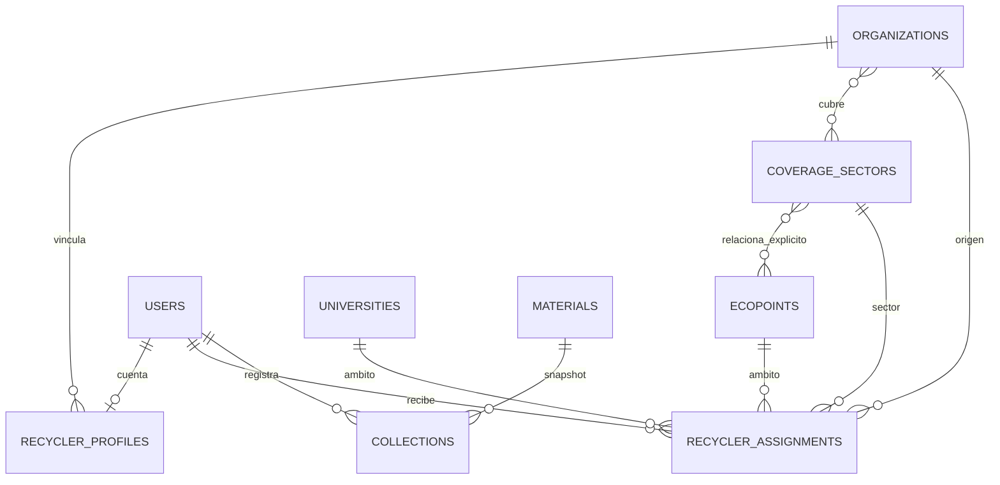

# Organizaciones y recicladores

## Modelo de relaciones

La tabla puente `organization_sectors` conserva la cobertura actual. `sector_ecopoints` registra las relaciones explícitas sector-EcoPunto, sin deducir localidades desde dirección o universidad. Los cambios de cobertura se reflejan como cierre lógico de asignaciones automáticas activas y creación de filas nuevas; las asignaciones anteriores no se borran. Las asignaciones por universidad son permisos amplios; las automáticas derivadas de cobertura identifican el EcoPunto y no se amplían a toda su universidad.

`RecyclerProfile` diferencia `ORGANIZATION` e `INDEPENDENT`, almacena datos opcionales de documento y teléfono, y estado. La cuenta vive en `users`; el inicio de sesión usa el flujo JWT existente. Un perfil suspendido no puede registrar recolecciones y una cuenta suspendida no puede iniciar sesión.

Al crear recicladores por API, `link_type` puede omitirse: si se envía `organization_id`, se infiere `ORGANIZATION`; si no, se infiere `INDEPENDENT`. Si se envía `link_type` explícitamente, debe ser coherente con `organization_id`. La organización debe existir y estar activa. La interfaz administrativa envía ambos campos explícitamente.

## API añadida

Todas las rutas usan `/api/v1` y requieren Bearer salvo donde se indica.

| Método | Ruta | Acceso | Uso |
|---|---|---|---|
| GET, POST | `/recyclers/organizations` | ADMIN | Listar con `q`, `type`, `state`; crear |
| PATCH, DELETE | `/recyclers/organizations/{id}` | ADMIN | Editar/activar/suspender; borrar si no hay perfiles ni historial |
| PUT | `/recyclers/organizations/{id}/coverage` | ADMIN | Reemplazar sectores; EcoPuntos se derivan de sus relaciones sectoriales explícitas |
| GET, POST | `/recyclers/sectors` | ADMIN | Buscar/listar y crear sectores |
| PATCH, DELETE | `/recyclers/sectors/{id}` | ADMIN | Editar/activar/suspender; borrar solo sin cobertura o historial |
| PUT | `/recyclers/sectors/{id}/ecopoints` | ADMIN | Reemplazar EcoPuntos relacionados explícitamente |
| GET, POST | `/recyclers` | ADMIN | Buscar/listar/crear cuenta y perfil |
| PATCH | `/recyclers/{id}` | ADMIN | Editar correo, nombre, vínculo, contacto y estado |
| GET | `/recyclers/organizations/{id}/recyclers` | ADMIN | Integrantes |
| GET | `/recyclers/assignments` | ADMIN o sus propias filas RECYCLER | Filtra por organización, perfil, sector, universidad, EcoPunto y estado |
| POST | `/recyclers/assignments` | ADMIN | Crear autorización directa para un independiente |
| PATCH | `/recyclers/assignments/{id}` | ADMIN | Cambiar vigencia, notas o estado (automáticas se administran desde la cobertura) |
| GET | `/recyclers/me` | RECYCLER | Perfil propio |
| GET | `/recyclers/me/dashboard` | RECYCLER | Asignaciones propias, operaciones e indicadores calculados |

La operación existente `POST /collections` sigue registrando la recolección con el usuario autenticado. Comprueba autorización activa y vigente, estado del perfil, estado activo del EcoPunto/compartimento, compartimento perteneciente al punto y peso disponible. `GET /collections` y `/collections/{id}` muestran únicamente recolecciones propias a RECYCLER.

## Recorrido en la interfaz

1. Abrir **Recicladores y organizaciones → Organizaciones** y crear la organización, completando datos y estado `ACTIVE`.
2. En la misma pestaña, crear cada sector con nombre, localidad y ciudad. La ciudad inicial es Bogotá; el formulario permite cambiarla.
3. En **EcoPuntos del sector**, seleccionar los puntos confirmados y pulsar **Guardar puntos**. Esta relación explícita es necesaria para autorizar recolecciones de cobertura.
4. Editar la organización, seleccionar los sectores que cubre y guardar. Los EcoPuntos se derivan de las relaciones sectoriales; la lista del formulario sirve como comprobación/selección, no como geocodificación.
5. En **Recicladores**, seleccionar `Organización`, elegir una entidad activa y crear la cuenta con correo único y contraseña de al menos 12 caracteres. El backend crea usuario, perfil y asignaciones automáticas. Para independientes, seleccionar `Independiente`; no se crea una organización-persona. En integraciones de API, omitir `link_type` hace que el backend lo infiera desde `organization_id`.
6. En **Asignaciones**, filtrar y consultar origen `AUTOMATIC`. Para una persona independiente, crear una autorización `DIRECT` indicando al menos sector, universidad o EcoPunto. Una autorización por EcoPunto no habilita otros puntos de la misma universidad.
7. Cerrar sesión ADMIN e iniciar sesión con el correo y contraseña iniciales del reciclador. El dashboard carga su perfil, organización/estado independiente, asignaciones, recolecciones, pesos y categorías. En alertas y recolecciones se puede registrar solo en puntos que el backend autorice.

## Migración SQLite

`upgrade_recycler_university_optional(engine)` es explícita e idempotente, no se llama desde el arranque. Conserva filas y hashes al relajar la restricción histórica de `users`, y agrega columnas opcionales nuevas a perfiles, asignaciones y recolecciones existentes. Las nuevas tablas puente se crean cuando `Base.metadata.create_all` corre tras la migración. No ejecutamos este proceso sobre la base local/real.

Para evaluar una copia manualmente desde `backend/`, usa dos rutas nuevas: `python scripts/migrations/migrate_recycler_module.py --database <copia.sqlite> --backup <copia.pre-recycler.sqlite>`. El script rechaza sobrescribir el archivo de backup y valida `integrity_check`, `foreign_key_check` y hash. Haz la primera prueba sobre un duplicado desechable y verifica la salida antes de considerar un despliegue. La migración no asigna automáticamente puntos a recicladores antiguos; sus cuentas y permisos necesitan una decisión explícita de ADMIN.

## Verificación pendiente

Hay pruebas aisladas para migración y API en `backend/tests/test_sqlite_migrations.py` y `backend/tests/test_recycler_module.py`. Deben ejecutarse con el Python/dependencias de `backend/requirements.txt`. La base del repositorio no se usó para estas instrucciones. Pytest todavía requiere ejecución en un entorno Python accesible.
